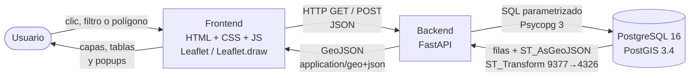
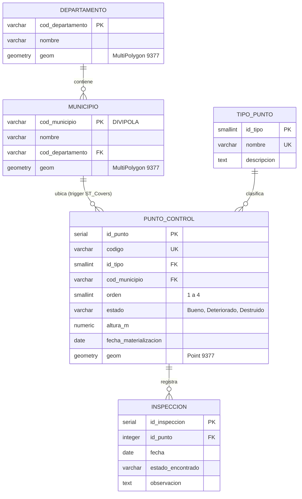

# Geovisor SIG Web · Red de puntos de control topográfico del Quindío

Visor SIG Web que consulta una geodatabase **PostgreSQL/PostGIS** de cinco tablas relacionadas mediante una API **FastAPI** (conexión con **Psycopg 3**) y representa los resultados en **Leaflet**. Toda la información geográfica está en **MAGNA-SIRGAS / Origen-Nacional (EPSG:9377)**.

> **Autor:** Jhon Jair Obregon · Programación para SIG · Ingeniería Topográfica y Geomática · 2026

---

## 1. Objetivo y problema geográfico

Antes de un levantamiento topográfico hay que saber **con qué puntos de control cuenta la zona de trabajo**: dónde están, de qué tipo y orden son, si siguen en buen estado y a qué distancia y en qué dirección quedan del sitio de trabajo.

Este proyecto responde cuatro preguntas sobre la red de puntos de control del Quindío:

1. **¿Dónde está la red y en qué estado se encuentra?** (F1)
2. **¿Qué puntos cumplen un criterio técnico (tipo, estado, orden, municipio) y cuál es su historial?** (F2)
3. **¿Qué puntos sirven de amarre para un levantamiento en una ubicación dada, a qué distancia y con qué azimut?** (F3)
4. **¿Cuántos puntos utilizables tiene una zona de proyecto y qué municipios abarca?** (F4)

Además, F5 muestra qué municipios tienen **menor cobertura** de la red.

## 2. Arquitectura



| Componente | Tecnología | Responsabilidad | Archivo |
|---|---|---|---|
| Frontend | HTML, CSS, JavaScript, Leaflet 1.9, Leaflet.draw | Interacción, mapa y representación de resultados | `frontend/` |
| API | Python 3.10+, FastAPI | Endpoints, validación de parámetros y armado del GeoJSON | `backend/main.py` |
| Conexión | Psycopg 3 | Ejecución de SQL parametrizado | función `consultar()` en `backend/main.py` |
| Geodatabase | PostgreSQL + PostGIS | Almacenamiento, relaciones, reglas e índices espaciales | `sql/` |
| Intercambio | HTTP, JSON/GeoJSON | Comunicación entre navegador y API | — |

El navegador **nunca se conecta a PostgreSQL**. Todas las consultas pasan por la API, y las credenciales se leen del archivo `.env`, que no se sube al repositorio. El frontend no tiene datos precargados: todos los resultados vienen de PostGIS.

## 3. Geodatabase

### 3.1 Modelo relacional (5 tablas)



| Tabla | Registros | Geometría | Papel en el problema |
|---|---:|---|---|
| `departamento` | 1 | `MultiPolygon`, EPSG:9377 | Límite del Quindío; contorno de F1 y control de cobertura |
| `municipio` | 12 | `MultiPolygon`, EPSG:9377 | Jurisdicción donde está cada punto; base de F4 y F5 |
| `tipo_punto` | 3 | — | Catálogo: vértice GNSS, placa de nivelación, mojón de poligonal |
| `punto_control` | 129 | `Point`, EPSG:9377 | Entidad principal de la red |
| `inspeccion` | 326 | — | Historial de visitas de campo (relación 1:N con el punto) |

### 3.2 Integridad y reglas implementadas en la base

- **Claves primarias** en las cinco tablas. **Claves foráneas:** `municipio → departamento`, `punto_control → tipo_punto`, `punto_control → municipio` e `inspeccion → punto_control` (con `ON DELETE CASCADE`).
- **Restricciones:** `CHECK` de geometría válida, dominio de `estado` y rango de `orden`; `UNIQUE` en `codigo` y en `(id_punto, fecha)` de `inspeccion`.
- **Trigger espacial `trg_asignar_municipio`:** al insertar o mover un punto, la base le asigna el municipio con `ST_Covers`, sin depender de la digitación.
- **Trigger temático `trg_actualizar_estado_punto`:** al registrar una inspección, el estado vigente del punto pasa a ser el de la inspección más reciente.
- **Índices GiST** sobre la geometría de las tres tablas espaciales (para KNN `<->`, `ST_DWithin`, `ST_Covers` y `ST_Intersects`).

### 3.3 Sistema de referencia y unidades

**Toda la geodatabase está en EPSG:9377 (MAGNA-SIRGAS / Origen-Nacional)**, el sistema de coordenadas planas oficial de Colombia (Resolución IGAC 471 de 2020). Están en ese sistema los límites, los puntos de control y todas las mediciones.

| Etapa | SRC | Unidades | Detalle |
|---|---|---|---|
| Almacenamiento (`departamento`, `municipio`, `punto_control`) | **EPSG:9377** | metros | Coordenadas Este/Norte con precisión de milímetro |
| Distancias, áreas, perímetros, azimutes y KNN | **EPSG:9377** | m, km², grados | Cálculo plano, como en topografía. El azimut es de cuadrícula (desde el norte de la proyección). |
| Entrada de ubicaciones | EPSG:9377 o WGS 84 | m o grados | F3 acepta Este/Norte digitados; el clic en el mapa llega en lon/lat y PostGIS lo transforma a 9377 (`ST_Transform`) antes de calcular |
| Salida al navegador | WGS 84 (EPSG:4326) | grados | Solo la geometría del GeoJSON. El estándar GeoJSON (RFC 7946) exige longitud/latitud, y Leaflet y los mapas base trabajan así. Las coordenadas Este/Norte viajan como atributos. |

**Control de la deformación de la proyección:** la distancia geodésica, calculada sobre el elipsoide, se muestra en F3 solo como comparación. Para el Quindío, el área plana del departamento en 9377 es 1 931,03 km² y la geodésica 1 929,86 km² (+0,06 %). Las distancias planas salen cerca de 0,03 % mayores que las geodésicas. Esto concuerda con el factor de escala de la Transversa de Mercator de Origen Nacional (k₀ = 0,9992 en el meridiano −73°), que crece al alejarse hacia el occidente, donde está el Quindío (cerca de −75,7°).

### 3.4 Fuentes y procedencia de los datos

| Dato | Fuente | Observaciones |
|---|---|---|
| Límite departamental (1) | Capa `LIMITE_QND` de la Corporación Autónoma Regional del Quindío (CRQ), en MAGNA-SIRGAS / Colombia Oeste (EPSG:3115). Información pública (Ley 1712 de 2014). | Reproyectada a EPSG:9377 y llevada a 2D (la capa trae coordenada Z). Área plana en 9377: 1 931,03 km². |
| Límites municipales (12) | Capa `MUN_QND` de la CRQ, POMCA Quindío (EPSG:3115), con 11 municipios. **Armenia no viene en la capa**: se reconstruyó como el área del límite departamental que no cubren los otros 11 municipios (123,38 km²). | Cada municipio se recortó al límite departamental. Se descartaron 298 astillas de borde (0,8 ha en total) producidas por diferencias de digitalización entre las dos capas. La capa trae dos códigos DIVIPOLA errados (Buenavista 15109 y Córdoba 52215), así que el código se asignó por nombre (63111 y 63212). Los 12 municipios suman 1 931,03 km², igual al departamento. |
| Puntos de control (129) e inspecciones (326) | **Datos sintéticos** generados con `sql/herramientas/generar_datos.py` (semilla fija, reproducible) | Son puntos aleatorios dentro de cada municipio, generados directamente en EPSG:9377, con atributos verosímiles. **No son vértices oficiales del IGAC.** Sirven para demostrar el funcionamiento; la estructura admite cargar datos reales sin cambiar la API ni el visor. |

## 4. Funcionalidades y relación endpoint ↔ consulta

| # | Capacidad | Acción en el visor | Endpoint | Operaciones PostgreSQL/PostGIS |
|---|---|---|---|---|
| **F1** | Visualización geográfica | Al abrir el visor; simbología por estado o por tipo | `GET /api/departamento`<br>`GET /api/municipios`<br>`GET /api/puntos` | `JOIN` entre tablas, `ST_Area` en 9377, `ST_Transform` a WGS 84 y `ST_AsGeoJSON` para la salida |
| **F2** | Consulta de atributos | Formulario de filtros; clic en un punto o en una fila | `GET /api/puntos/buscar?tipo=&estado=&orden_max=&municipio=&texto=`<br>`GET /api/puntos/{codigo}` | Filtro combinado con `JOIN` de 3 a 4 tablas; historial de `inspeccion`; Este/Norte con `ST_X`/`ST_Y` |
| **F3** | Consulta espacial: puntos de amarre | Clic en el mapa o Este/Norte digitados | `GET /api/amarre?este=&norte=&n=&solo_buenos=`<br>(o `lon=&lat=` desde el clic) | KNN `<->`, `ST_Distance` y `ST_Azimuth` en 9377, `ST_Transform`, `ST_DWithin` (validación), `ST_Covers`, `ST_MakeLine` |
| **F4** | Complementaria: análisis de zona de proyecto | Dibujar un polígono | `POST /api/zona/analisis` | `ST_GeomFromGeoJSON`, `ST_Transform` a 9377, `ST_MakeValid`, `ST_Area`, `ST_Perimeter`, `ST_Covers`, `ST_Intersection`, `COUNT … FILTER` |
| F5 | Adicional: cobertura municipal | Botón «Generar mapa temático» | `GET /api/municipios/cobertura?estado=` | Unión espacial `LEFT JOIN … ON ST_Covers` + `GROUP BY`, densidad por `ST_Area` en 9377 |

Servicios de apoyo: `GET /api/salud` (estado de la conexión) y `GET /api/catalogos` (listas de los filtros, leídas desde la base). La documentación interactiva de todos los endpoints está en `http://127.0.0.1:8000/docs`.

### Justificación técnica de las operaciones espaciales

- **F3, KNN `<->`:** en 9377 las geometrías están en metros, así que `<->` ordena por la distancia plana real usando el índice GiST. Es la operación adecuada para «los n más cercanos», porque no exige fijar un radio. `sql/04_consultas_contraste.sql` lo contrasta con un ordenamiento por la distancia exacta y ambos coinciden.
- **F3, `ST_Distance` y `ST_Azimuth` en 9377:** dan la distancia horizontal en el plano y el azimut de cuadrícula, que son los datos que se usan en campo para un amarre con coordenadas planas. El script de contraste los recalcula a mano con las fórmulas de topografía plana, d = √(ΔE² + ΔN²) y Az = atan2(ΔE, ΔN), y obtiene los mismos valores.
- **F3, distancia geodésica:** se muestra junto a la plana para evidenciar la deformación de la proyección. En la prueba, 2 476,104 m en el plano frente a 2 475,353 m sobre el elipsoide (+0,03 %).
- **F3, validación de la ubicación:** `ST_DWithin` con el límite departamental (margen de 5 km) rechaza ubicaciones fuera del área de trabajo con HTTP 422.
- **F4, `ST_Covers` (y no `ST_Contains`):** incluye los puntos que caen exactamente en el borde del polígono. El polígono dibujado llega en WGS 84 y se transforma a 9377; luego `ST_Intersection` + `ST_Area` reparten la zona entre municipios en km².
- **F5, unión espacial `ST_Covers`:** se comprueba contra el conteo por llave foránea. Ambos coinciden en los 12 municipios, lo que valida el trigger de asignación.
- **Seguridad:** todas las consultas que reciben valores del usuario usan parámetros de Psycopg (`%(nombre)s`); nunca se concatenan cadenas. FastAPI valida tipos, rangos y patrones (por ejemplo, el código DIVIPOLA debe ser `^\d{5}$`).

## 5. Instalación y ejecución (Windows)

**Requisitos:** PostgreSQL 14 o superior con PostGIS 3 (se instala con *Stack Builder*), Python 3.10 o superior y Git (opcional).

### 5.1 Crear y cargar la geodatabase

En pgAdmin, cree la base `geovisor_control` y ejecute en *Query Tool*, **en este orden**, `sql/01_esquema.sql`, `sql/02_datos.sql` y `sql/03_verificacion.sql`. También puede hacerlo por consola:

```bat
psql -U postgres -c "CREATE DATABASE geovisor_control;"
psql -U postgres -d geovisor_control -f sql/01_esquema.sql
psql -U postgres -d geovisor_control -f sql/02_datos.sql
psql -U postgres -d geovisor_control -f sql/03_verificacion.sql
```

### 5.2 Preparar Python y las credenciales

```bat
python -m venv .venv
.venv\Scripts\activate
pip install -r requirements.txt
copy .env.example .env
```

Edite `.env` y escriba la contraseña de PostgreSQL. Este archivo está en `.gitignore` y no se publica.

### 5.3 Ejecutar

```bat
python backend\probar_conexion.py
uvicorn backend.main:app --reload
```

- Visor: <http://127.0.0.1:8000>
- Documentación de la API (Swagger): <http://127.0.0.1:8000/docs>

### 5.4 Prueba automática de la API y contraste con SQL

Con la API en ejecución, en otra terminal:

```bat
python pruebas\probar_api.py
```

El script llama cada endpoint, guarda las respuestas en `evidencias/api/`, repite cada operación directamente en PostgreSQL y compara los resultados.

## 6. Verificación y evidencias

| Evidencia | Archivo | Qué demuestra |
|---|---|---|
| Peticiones HTTP del visor | `evidencias/red/registro_peticiones_visor.txt` | Método, código de estado y endpoint de cada acción del usuario, capturados en el navegador |
| Panel «Peticiones a la API» | Visible en las capturas | El visor registra cada petición, su estado HTTP, el tiempo de respuesta y el número de entidades recibidas |
| Respuestas de la API | `evidencias/api/*.json` | GeoJSON real de F1 a F5 y de los casos de error (404/422) |
| Contraste API ↔ SQL | `evidencias/red/resultado_probar_api.txt` | **17 de 17 comprobaciones correctas**: todas las geometrías en 9377 y los mismos registros, coordenadas, distancias, azimutes, áreas y conteos por la API y por SQL directo |
| Consultas reproducidas en PostgreSQL | `sql/04_consultas_contraste.sql` → `evidencias/sql/salida_04_consultas_contraste.txt` | Las operaciones de F1 a F5 ejecutadas en `psql`, independientes de la interfaz |
| Integridad de la geodatabase | `evidencias/sql/salida_03_verificacion.txt` | Llaves foráneas, geometrías válidas, cobertura municipal completa del departamento, triggers coherentes; la base rechaza datos inválidos (FK, CHECK, UNIQUE) |
| Interfaz | `evidencias/capturas/` | Visor funcionando (F1 a F5), Swagger y respuesta GeoJSON vista en el navegador |

### Matriz de verificación

| Caso | Procedimiento | Resultado obtenido |
|---|---|---|
| SRC | `geometry_columns` y `GET /api/salud` | Las 3 columnas geométricas en SRID 9377 |
| F1 | Abrir el visor | `GET /api/departamento` 200 (1; 1 931,03 km² en el plano) · `GET /api/municipios` 200 (12) · `GET /api/puntos` 200 (129) |
| F2 búsqueda | Tipo = Vértice GNSS, Estado = Bueno, Orden ≤ 1 | 200 · 10 puntos, idénticos a la consulta SQL |
| F2 ficha | `GET /api/puntos/NIV-001-001` | E = 4 691 846,787 m · N = 2 055 069,933 m y 4 inspecciones; iguales en SQL |
| F2 inválido | `GET /api/puntos/NO-EXISTE` · `?municipio=abc` | 404 · 422 |
| F3 por coordenadas | `este=4702599.150&norte=2059542.011`, n = 3 | POL-001-002 a 2 476,104 m (Az 298,6918°); POL-001-001 a 2 564,503 m (Az 295,6549°); POL-190-002 a 4 533,438 m (Az 23,7297°); iguales en SQL y en el cálculo manual |
| F3 por clic | `lon=-75.6811&lat=4.5339` | Los mismos 3 puntos (el clic se transforma a 9377) |
| F3 fuera del área | `este=4880000&norte=2050000` · sin ubicación | 422 · 422 |
| F4 | Rectángulo (−75,75; 4,48) a (−75,62; 4,60) | 191,5495 km² · 55 408,90 m · 11 puntos (9 utilizables) · 7 municipios que suman 100 % |
| F4 inválido | Enviar un `Point` | 422 |
| F5 | Cobertura con estado = Bueno | 12 municipios; conteo espacial = conteo por FK |
| Integridad | `03_verificacion.sql` | 0 geometrías inválidas · municipios = departamento (hueco < 0,01 km²) · 0 puntos sin municipio · 0 estados inconsistentes · FK/CHECK/UNIQUE rechazan inserciones inválidas |

## 7. Recorrido completo de una operación (F3 · puntos de amarre)

1. **Acción del usuario:** en F3 escribe las coordenadas de la Plaza de Bolívar de Armenia, Este 4 702 599,150 y Norte 2 059 542,011 (EPSG:9377), y pulsa «Buscar por coordenadas EPSG:9377». También puede hacer clic en el mapa.
2. **Frontend** (`frontend/app.js`, función `ejecutarAmarre`): arma la petición y la envía con `fetch()`:
   `GET /api/amarre?este=4702599.15&norte=2059542.011&n=3&solo_buenos=true`
3. **API** (`backend/main.py`, función `puntos_de_amarre`): FastAPI valida tipos y rangos (`n` entre 1 y 10) y comprueba con `ST_DWithin` que la ubicación esté en el Quindío. Luego ejecuta con Psycopg la consulta parametrizada, toda en EPSG:9377:
   ```sql
   WITH origen AS (SELECT ST_SetSRID(ST_MakePoint(%(este)s, %(norte)s), 9377) AS g)
   SELECT p.codigo,
          ST_Distance(o.g, p.geom)                  AS distancia_plana_m,
          degrees(ST_Azimuth(o.g, p.geom))          AS azimut_cuadricula_grados,
          ST_AsGeoJSON(ST_Transform(p.geom, 4326))  AS geometria   -- solo para Leaflet
     FROM punto_control p CROSS JOIN origen o
    WHERE (NOT %(solo_buenos)s OR p.estado = 'Bueno')
    ORDER BY p.geom <-> o.g
    LIMIT %(n)s;
   ```
4. **Respuesta:** la API convierte las filas en una `FeatureCollection` (`application/geo+json`) con los 3 puntos. Cada uno lleva sus coordenadas Este/Norte, la distancia plana, el azimut de cuadrícula, la distancia geodésica de comparación y la línea de amarre. Ver `evidencias/api/F3_amarre_plaza_bolivar_9377.json`.
5. **Resultado cartográfico:** Leaflet dibuja la ubicación, los 3 puntos numerados y las líneas de amarre, y muestra en la barra lateral la tabla de distancias y azimutes (`evidencias/capturas/05_F3_puntos_de_amarre.png`).
6. **Verificación independiente:** la misma consulta, ejecutada en `psql` (`sql/04_consultas_contraste.sql`), devuelve los mismos tres códigos, distancias y azimutes. El cálculo manual √(ΔE² + ΔN²) y atan2(ΔE, ΔN) también coincide (`evidencias/sql/salida_04_consultas_contraste.txt`).

## 8. Estructura del repositorio

```
├── backend/
│   ├── main.py                  API FastAPI (F1 a F5, validación, GeoJSON)
│   └── probar_conexion.py       Prueba rápida de conexión a la base
├── frontend/
│   ├── index.html               Estructura del visor y barra lateral
│   ├── style.css                Estilos
│   └── app.js                   Leaflet, eventos y peticiones fetch()
├── sql/
│   ├── 01_esquema.sql           Tablas, llaves, índices, triggers y vista
│   ├── 02_datos.sql             Carga de datos
│   ├── 03_verificacion.sql      Estructura, integridad y reglas
│   ├── 04_consultas_contraste.sql  Consultas de F1 a F5 reproducidas en SQL
│   └── herramientas/generar_datos.py  Script que genera 02_datos.sql desde las capas de la CRQ
├── pruebas/
│   └── probar_api.py            Prueba de endpoints y contraste API ↔ SQL
├── evidencias/
│   ├── api/                     Respuestas JSON/GeoJSON de la API
│   ├── sql/                     Salidas de psql
│   ├── red/                     Registro de peticiones HTTP y resultado de las pruebas
│   └── capturas/                Capturas del visor, Swagger y GeoJSON
├── .env.example                 Plantilla de configuración (sin secretos)
├── .gitignore                   Excluye .env, .venv y caché
├── requirements.txt
└── README.md
```

## 9. Relación con el proyecto de referencia del curso

Del Módulo 05 (SIG Web del Quindío) se adoptaron los **patrones de arquitectura** del curso: FastAPI con Psycopg, credenciales en `.env`, `ST_AsGeoJSON`, respuestas `FeatureCollection` y el servidor que publica el frontend. El **problema, los datos y las consultas son propios**:

| Aspecto | Proyecto de referencia | Este proyecto |
|---|---|---|
| Tema | Equipamientos educativos y de salud | Red de puntos de control topográfico |
| Modelo | Municipios y equipamientos | 5 tablas: departamento, municipio, tipo_punto, punto_control e inspeccion, con 2 triggers de integridad |
| Consulta espacial | Proximidad por radio (`ST_DWithin`) | Vecinos más cercanos (KNN `<->`) en el plano EPSG:9377, con azimut de cuadrícula, entrada por Este/Norte y comparación con la distancia geodésica |
| Complementaria | Selección por código municipal | Análisis de un polígono dibujado (área, perímetro, contenidos, reparto por municipio) y coropleta de cobertura |
| Atributos | Detalle de un municipio | Filtro combinado de 5 criterios y ficha con historial de inspecciones |

## 10. Limitaciones

- Los puntos de control y las inspecciones son **sintéticos**. Los resultados demuestran el funcionamiento del sistema, no el estado real de la red geodésica del Quindío.
- Las capas fuente de la CRQ no se incluyen en el repositorio: su contenido ya está en `sql/02_datos.sql`. Para regenerarlo con `generar_datos.py` se necesitan `LIMITE_QND.shp` y `MUN_QND.shp`, que se solicitan a la CRQ.
- `altura_m` es un valor aproximado de prueba y no corresponde a una altura nivelada ni a una altura elipsoidal medida.
